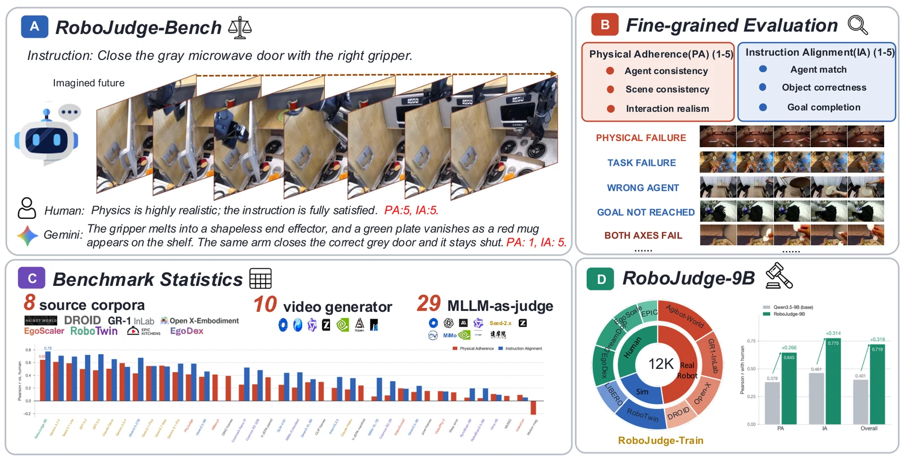

# RoboJudge

**Multimodal Language Models as Judges for Embodied Video Generation**

RoboJudge evaluates generated embodied videos on **Physical Adherence (PA)**
and **Instruction Alignment (IA)**.

[Project Page](https://siyuanmacs.github.io/RoboJudge/) ·
[Model](https://huggingface.co/HuggingFriends/RoboJudge-9B) ·
[Benchmark](https://huggingface.co/datasets/HuggingFriends/RoboJudge-Bench) ·
[Training Data](https://huggingface.co/datasets/HuggingFriends/RoboJudge-Train) ·
[Training](TRAINING.md)



## Highlights

- **RoboJudge-Bench:** 800 human-annotated videos, 8 source corpora, and 10
  video generators.
- **RoboJudge-Train:** 12K videos with 25K human scores and rationales.
- **RoboJudge-9B:** Pearson `0.645` on PA, `0.775` on IA, and `0.719` overall.

## Contents

```text
code/inference.py          RoboJudge-9B inference
code/evaluate.py           RoboJudge-Bench evaluation
code/sft/                  supervised fine-tuning
code/rl/                   GRPO training and reward
data/benchmark/            800-item benchmark
data/train/                released training annotations
docs/                      project page and demo assets
```

## Quick start

```bash
python -m pip install -r requirements.txt
huggingface-cli download HuggingFriends/RoboJudge-Bench \
  --repo-type dataset --local-dir data_root

CKPT=HuggingFriends/RoboJudge-9B \
DATA_ROOT="$PWD/data_root" \
LIMIT=4 \
bash code/run_inference.sh

python code/evaluate.py \
  outputs/predictions.jsonl \
  data/benchmark/robojudge_bench.jsonl
```

For SFT and GRPO commands, see [TRAINING.md](TRAINING.md).

## License

Code is released under Apache-2.0. Model and dataset use is additionally
subject to their upstream terms.
